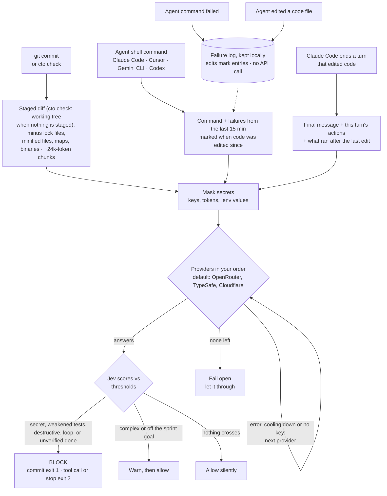

# your-cto-jev

**A sharp-tongued CTO that reviews what your AI coding agent is about to do, and says no.**

`cto` hooks into `git commit` and into Claude Code, Cursor, Gemini CLI and Codex. Before a commit lands, before an agent runs a shell command, and when an agent says it is done, it asks [TypeSafe Jev](https://developers.cloudflare.com/ai/models/typesafe/jev/), a typed decision model, a few yes/no questions. Then it blocks, warns, or stays completely silent.

```text
$ git commit -m "add payments"
[cto] Nice one, genius. You almost pushed a secret into Git. Commit BLOCKED. Remove it.
      credential_leak = 0.94 (threshold > 0.5)

# Claude Code tries: rm -rf ~
[cto] Hold it. This command is irreversibly destructive. Not running it.
      destructive_command = 0.96 (threshold > 0.7)

# Same build fails twice, agent tries the exact same thing again
[cto] Same error again. You are looping and burning tokens. This tool call is BLOCKED. Fix the logic first.
      infinite_loop = 0.95 (threshold > 0.6)
```

Messages come in English or 繁體中文, picked from your locale.

## Why

Coding agents move fast and occasionally do something you would never approve: commit an API key, `rm -rf` the wrong directory, force-push over a shared branch, or retry the same failing command until your token budget is gone. Regex scanners catch some of this, but they cannot tell a real key from a placeholder, or a cleanup from a disaster.

Jev judges meaning and answers with probabilities, not prose. It costs about $0.00002 per check and answered in about 250 ms (p95 about 330 ms) in our tests. `cto` adds the hooks, the thresholds and the attitude.

## What it checks

| Signal | Where | What happens |
|---|---|---|
| `credential_leak` | every `git commit` | **Blocks** the commit |
| `test_tampering` | `git commit`s that touch tests or test config | **Blocks** the commit |
| `destructive_command` | every agent shell command | **Blocks** the command |
| `infinite_loop` | agent shell commands, after a recent failure | **Blocks** the command |
| `done_unverified` | an agent ending a turn that edited code or checked off plan items | **Sends it back to work** until the change is verified or the gap is disclosed |
| `architecture_violation` | `git commit`, once you set a sprint goal, or when the [development flow](#the-development-flow-optional) maps the commit to a feature's SPEC | Warns only |
| `architecture_undocumented` | `git commit` under the development flow, when code changes and no decision record is added | Warns only |
| `manual_measurable` | `git commit` under the development flow, when it adds a task accepted `manual` that a script could check instead | Warns only |
| `code_complexity` | every `git commit` | Warns only |

`test_tampering` catches the classic agent shortcut: making a red test green by skipping it, deleting its assertions, loosening the expectation, or lowering the coverage bar, instead of fixing the code. It lets through real fixes, new or tighter tests, refactors, and tests removed together with their feature.

`done_unverified` catches the other classic shortcut: "Done, all tests pass!" when nothing ran after the last edit, the last run failed, or the claim is not backed by anything the agent actually did. It lets through turns that ran a passing check after the last edit, turns that changed only docs or CI config, and turns where the agent honestly says what it could not verify. Checked-off items count even when the agent committed them in the same turn. For a task with an acceptance line (`accept:` or `驗收:`), cto itself works out whether that exact command ran and passed after the last edit and tells Jev, and a `(dropped: ...)` task the final message does not report as dropped is sent back without asking Jev at all. A ticked `manual` task never blocks: cto shows you what to look at. A task whose acceptance was a command and is switched to `manual` in the turn it is ticked is judged against that old command (when cto recorded where the turn started; otherwise against the last commit). It blocks at most once per stop, so it cannot loop.

Checking off a plan item is the same claim. Whatever planning tool you use (spec-kit, GSD, Kiro, specOS, a hand-written `TODO.md`), plans end up as markdown checklists, so `cto` reads the uncommitted `- [ ]` to `- [x]` changes in tracked `.md` files and asks whether the turn backs them up. A phase or parent item counts as backed when everything nested under it is checked, or when the turn ran a passing check that covers it. Each tick is judged once. A turn that only ticks boxes, without doing the work, is checked too.

Some checks need no model at all. They run first, before anything is sent anywhere, and they work with no API key:

| Local check | Where | What happens |
|---|---|---|
| Commit on a branch listed in `protected_branches` | `git commit` | **Blocks** |
| Deleting or rewriting history of a protected branch | `git push` (pre-push hook) | **Blocks**, whatever ran the push: agent, human, GUI |
| Merge conflict markers in added lines | `git commit` | **Blocks** |
| A `.env` file with values (not `.env.example`) | `git commit` | **Blocks** |
| A file over 5 MB | `git commit` | Warns |
| `package.json` dependencies changed, lock file not | `git commit` | Warns |
| Development flow: a feature with tasks whose CONCEPT is not `Status: approved` | `git commit` touching that feature | **Blocks** |
| Development flow: INDEX.md older than its inputs, an `(after:)` id nobody defines, a SPEC `## Interface` changed | `git commit` | Warns |

`protected_branches` is empty by default; set it in `.cto.json` (`["main"]`) and the whole team's agents stop committing to main by accident. A commit a local check blocks never reaches Jev.

Architecture and complexity only warn on purpose. They are subjective, and a gate that blocks too often teaches people to use `git commit --no-verify`, which switches off the secret check too.

When nothing crosses a threshold, `cto` prints nothing at all.

## How it works



A provider that fails is skipped for 5 minutes after a timeout, `429` or `5xx`, or for 1 hour after an auth or billing error, then retried. A `400` means the request itself is wrong, so `cto` fails open without trying the other provider.

## Quick start

Requires Node.js 22 or newer.

```sh
npm install -g your-cto-jev
cd your-project
cto setup
```

To update later, run `cto update`. Projects you already set up pick up the new version automatically: every hook only calls `cto`, and all the logic lives in the package. `cto` checks npm for a new version at most once a day and mentions it in its once-per-session notice, never on its own.

`cto setup` walks you through four steps with arrow keys: coding agents, Jev providers, API keys, and whether to use the [development flow](#the-development-flow-optional). Esc goes back a step. The agent list shows what is always installed (the git hooks, `.cto.json`) and the files each agent adds; before anything is written, setup lists every file it will create, update or remove and asks once. Providers are ticked in priority order, so the numbers you see are the failover order. Press a number to move the item under the cursor straight to that position:

```text
◆  Which Jev providers should cto use?
│  › [1] OpenRouter   easiest, one key (openrouter.ai)
│    [ ] TypeSafe     direct from the makers of Jev, one key
│    [2] Cloudflare   Account ID + API token; needs Authenticated Gateway and credits
│  Up/Down move · Space toggles · a number moves the item to that position · Enter confirms · Esc goes back
```

Each key is verified with one real request before it is saved. Keys you already stored are shown only by their last four characters, so you can keep them without pasting again.

Run `cto setup` again any time: it opens an overview of your current setup, and you can change one item without touching the rest. Changing only the order asks for nothing else; keys are asked only for newly added providers, and **Change API keys** in the overview replaces stored ones.

Then restart your agent session so it picks up the new hooks, and check that everything really works:

```sh
cto doctor
```

`cto doctor` sends one real request per provider, shows where each key comes from, checks the hooks in the current repo, shows when the last check ran, and counts how often a check was blocked or let through unchecked. It exits non-zero when something needs attention. Run it whenever you are unsure whether `cto` is protecting you: because `cto` fails open, a broken key looks exactly like a clean pass.

Both `setup` and `doctor` also look at what else is steering the agents, and say so when something could fight cto: other hooks on the same events (in the project and in your user-level settings), lines in `CLAUDE.md`, `AGENTS.md`, `GEMINI.md`, `.cursor/rules` or any installed skill that tell the agent to do what cto blocks (`--no-verify`, skip the tests, commit straight to main, force-push), and a skill installed both globally and in the project. Notes only, never a failure: cto writes its rules into the project and never into your global files, so a global rule that contradicts them is yours to sort out.

Other forms:

```sh
cto setup --agents claude,cursor --yes   # non-interactive (scripts, CI); only adds, never removes
cto setup --refresh                      # re-write hooks and rules for the agents already set up
cto setup --uninstall                    # remove every cto hook, rules block and skill again
cto setup --flow                         # turn on the development flow (docs/cto_jev, cto-jev skill, /cto-jev); --no-flow removes the skill and rule
cto doctor                               # is it actually working?
cto brief                                # what an agent should know before it starts here
cto check                                # preview the commit checks on your current changes
cto log                                  # recent decisions with scores; cto report [n] flags a wrong one
cto index                                # regenerate docs/cto_jev/INDEX.md (brief does this too)
cto docs                                 # suggest what to do with old planning markdown; changes nothing
```

`setup` appends marked blocks and merges JSON. It never overwrites your existing hooks or settings, and `--uninstall` puts them back exactly as they were. It never touches your shell rc files.

## The rules, written down for the agent

`cto setup` also writes the development rules of the repo for coding agents, where every rule names the check that enforces it. Agents read them before they work, so they get blocked less, and when they are blocked they know why and how to fix it.

The rules go where agents always look: a short marked block appended to `CLAUDE.md` (Claude Code), `AGENTS.md` (Codex, Cursor) and `GEMINI.md` (Gemini CLI), only for the agents you picked. Your own content in those files is left alone, and uninstall takes out exactly the block. The details, including what each check looks for and how to handle a block, live in one skill at `.agents/skills/cto/SKILL.md`; the rules block points every agent there.

| Rule | Enforced by |
|---|---|
| Secrets stay out of code | `credential_leak` blocks the commit |
| Fix the code, not the tests | `test_tampering` blocks the commit |
| Done means verified | `done_unverified` sends the agent back to work |
| Two strikes, change approach | `infinite_loop` blocks the retry once |
| Ask before anything irreversible | `destructive_command` blocks the command |
| Stay on the sprint goal, or inside the feature's SPEC | `architecture_violation` warns |
| Keep it simple | `code_complexity` warns |
| Work is planned in `docs/cto_jev/` (flow only); no work without sign-off | `flow_signoff` blocks the commit |

The rules also tell the agent to run `cto check` before committing, and never to bypass a block with `--no-verify` or by editing thresholds. Commit these files so the whole team's agents follow the same rules. `cto update` refreshes them (and any new hooks) in the repo you run it from; `cto doctor` flags a repo whose rules or hooks are older than the installed version, and `cto setup --refresh` brings it up to date.

`cto check` runs the commit checks on your staged changes (or, if nothing is staged, on every working-tree change including new files) without committing, and prints each score next to its threshold:

```text
[cto] Nothing staged, checking the working tree instead (9 files, including new untracked files):
  credential_leak            0.03   blocks above 0.5  ok
  test_tampering             0.03   blocks above 0.8  ok
  architecture_violation     not checked: no sprint_goal in .cto.json and no feature Constraints for these files
  architecture_undocumented  not checked: no docs/cto_jev/ flow, or this commit adds a decision record
  manual_measurable          not checked: this commit adds no task accepted manually
  code_complexity            2.02   warns above 2  would warn
[cto] Good to commit.
```

## What the agent knows before it starts

Gates say no after the fact. `cto brief` works before: it prints what an agent should know on its first turn in the repo, and Claude Code gets it automatically at session start (a `SessionStart` hook; the rules block tells the other agents to run it).

```text
[cto] brief · shop · main · 2 files uncommitted

Sprint goal   Ship Stripe billing, no new services
Verify with   npm test

Open plan items · TODO.md 3 · 3 unchecked
  - [ ] Add webhook handler
  - [ ] Retry on 5xx
  - [ ] Phase 2: docs

Lessons from this repo · 3 of 23 · unresolved and frequent first
  !! npx tsc          TS2307: Cannot find module './x.js'
                      seen 2x · last 3h ago · UNRESOLVED
  !  npm test         TypeError: Cannot read properties of undefined (reading 'map')
                      seen 3x · last 2d ago · fixed by editing src/turn.ts · verified by npm test
  -  git push         rejected: non-fast-forward
                      seen 1x · last 5d ago · fixed by editing src/a.ts · verified by git push

Failures in the last 15 min   none
Guards   secrets · test tampering · destructive commands · loops · unverified done
```

The lessons are collected without anyone writing them down. Every failed agent command is fingerprinted (the command's first two words plus its first telling error line, with numbers, quoted names and paths normalised) and counted in `.cto-lessons.jsonl`. When the same command later passes after code edits, the files edited in between are recorded as the fix. The file is masked like everything else cto writes, holds at most 200 lessons, and is one JSON line per lesson so teammates' additions merge without conflicts. Commit it: the whole team's agents then start with the repo's history of what breaks and what fixed it. No Jev call is involved.

`Verify with` comes from `test_command` in `.cto.json`, or is detected from `package.json`, a `Makefile`, pytest, Cargo or Go when it is empty. Open plan items are the unchecked `- [ ]` lines in tracked markdown files, whatever planning tool wrote them.

## The development flow (optional)

Everything above says no after the fact. The flow is the part before: your agent acts as the CTO of the repo (plans, breaks work down, dispatches, accepts), and `cto` keeps it honest. It is off by default; `cto setup --flow` (or the question at the end of interactive setup) turns it on, and repos that never enable it see no change.

The agent does not get a new tool. It gets one skill, `cto-jev` (`.agents/skills/cto-jev/SKILL.md`; in Claude Code also the `/cto-jev` command), a fixed place for plans, and a few more checks:

```text
docs/cto_jev/
  INDEX.md                 generated by cto: features, status, code paths, dependencies, sign-off
  PRODUCT.md               who it is for, how it earns, what it will not do
  ARCHITECTURE.md          stack, directory map, external services, the principles that do not change
  decisions/NNNN-<slug>.md decision records, append-only
  features/<slug>/
    CONCEPT.md             why: purpose, business rules, non-goals
    SPEC.md                how: ## Interface (what other features may use), ## Constraints, ## Acceptance, ## Internals
    TASKS.md               the only state: a checklist with ids, dependencies and an acceptance command
    REVIEW.md              what a zero-context reviewer found, and which tasks it became
```

A task is one checklist line, and everything else is computed from it:

```md
- [ ] CUST-1 Customer list
  - [x] CUST-1.1 List API, filtered by role (after: PERM-2) (files: src/customers/api/)
        accept: npm test -- customers/api
  - [ ] CUST-1.2 List UI (after: CUST-1.1) (files: src/customers/ui/, e2e/customers.spec.ts)
        accept: npx playwright test e2e/customers.spec.ts
  - [ ] CUST-1.3 List matches the brand (look) (after: CUST-1.2) (files: src/customers/ui/)
        accept: manual: list page against the brand sheet, at 375px and 1280px @ http://localhost:3000/customers
```

You sign one document per feature, the CONCEPT: what it is for, the business rules, what the user sees when it works, what is out of scope. After that the agent waits for you in two places only: that sign-off, and before the merge in `cto-jev release`. The SPEC is the agent's technical document, derived from the CONCEPT; nobody signs it and the agent may change it. Its `## Acceptance` lists each scenario as steps and a result a script can compare ("at 375px wide: no horizontal scroll"), each from a rule in the CONCEPT. A task you would see is accepted by the end-to-end test written from those lines before the code; if the agent thinks an expectation is wrong, the CONCEPT decides, and the Acceptance line changes before the test does. What the CONCEPT leaves open the agent decides and writes down as `Assumed:`; you read those in the release report. `manual` is left for taste (does it look right, does it match the brand) and blocks nothing: its line says what to look at and where (`manual: list page against the brand sheet @ http://localhost:3000/customers`), cto shows you that text when the turn ends, and the release report lists them all. A task that will not be done is closed with `(dropped: <reason>)` on its line, and the agent must say "<id> dropped" in its final message.

The trade: fewer stops, later discovery. A SPEC that drifted from what you meant shows up in the release review, not at a mid-way approval, and the agent writes both the code and its tests. The zero-context review before every commit is what stands in for you there: it checks the diff against the CONCEPT and asks of each acceptance test whether it would fail if its scenario broke.

`(after:)` says what must be ticked first, across features too; `(files:)` says what the task changes. Two optional tags: `(P1)`/`(P2)`/`(P3)` for priority (P1 first and nothing releases while one is open; no tag means P2; P3 last) and `(seq)` for a task that must run alone (migrations, shared types). From that, `cto brief` lists what is ready in priority order, what can run at the same time (no overlapping files, not `(seq)`), what is blocked and on whom:

```text
Features · 2 · 1 active · 1 planned · sign-off pending: billing (concept draft)

Ready · 3 (run together: CUST-1.2, PERM-3)
  CUST-1.2  P1 List UI  files src/customers/ui/, e2e/customers.spec.ts  accept: npx playwright test e2e/customers.spec.ts
  PERM-3    Role cache  files src/auth/cache/  accept: npm test -- auth
  CUST-2    Export  files src/customers/  accept: npm test -- export  (overlaps CUST-1.2: run after)

Blocked · 1
  CUST-1.4  Shared types              waiting on PERM-9 (missing), CUST-1.2
```

The skill gives the agent seven named jobs, so they cannot be confused with another skill's steps. In Claude Code type `/cto-jev <job>` (for example `/cto-jev init`); bare `/cto-jev` runs `cto brief` and names the job to run next. In other agents say the name, for example "cto-jev init" (Codex also takes `$cto-jev`):

| Say | The agent |
|---|---|
| `cto-jev init` | scans the repo, fills PRODUCT.md and ARCHITECTURE.md, asks you the rest a few questions at a time, walks you through the result until you say it is complete |
| `cto-jev feature` | talks the CONCEPT through first (who it is for, business rules, what the user sees when it works, what is out of scope, the simpler option it rejected), writes CONCEPT, then writes the SPEC itself (data migration and rollback, what other features may call, how a production failure gets noticed, the acceptance scenarios), has a zero-context reviewer check that a newcomer could build from them without making design decisions, that nothing unneeded or already in the code gets built and that every acceptance scenario has a result a script can check and a CONCEPT rule behind it, walks you through the CONCEPT, hands it over with a [Review handoff](#sign-off) and stops for your sign-off |
| `cto-jev tasks` | breaks a feature with a signed-off CONCEPT into parent/child tasks with files, dependencies and an acceptance command each |
| `cto-jev work` | dispatches Ready tasks to sub-agents with the narrowest brief, runs each acceptance command itself before ticking, has a zero-context reviewer read the diff **before every commit**: P1 findings are fixed first (and only the fixes reviewed again, at most three rounds in all; P1s left after that go to you), P2 findings become tasks, a finding is contested only with evidence the reviewer could read, then it commits the wave to the review branch and starts the next one, without asking, until nothing is Ready; tasks that need you (credentials, money, anything irreversible, a drop) are parked, not waited on; ends with one report of what is done and everything for you to look at. Never releases |
| `cto-jev work all` | for a new project or a big batch: the same run on a `work-all` branch with one zero-context review of everything at the end instead of one per wave. Never releases |
| `cto-jev release` | reviews the whole unreleased diff against the SPECs (looking hardest at waves marked `self-review`), files P1/P2/P3 tasks under the same findings rules, requires every P1 ticked and `cto check --base <release branch>` green, then prepares the merge, PR or tag for you to perform |
| `cto-jev docs` | runs `cto docs` and brings you the list; acts only on what you decide |
| `cto-jev decision` | writes an append-only decision record under `decisions/` |

"Release" adapts to the branches you have. A solo repo with only `main`: the wave review before each commit is the gate, and a release is a tag. `main` plus feature branches: the PR is the release. `main` plus `review`/`develop`/`staging`: merging the integration branch into `main`. `staging` and `live`: promoting one to the other. In every case the branch that reaches users takes nothing without a release review, and that is the branch to put in `protected_branches`. Changes inside an existing feature only add tasks; only a new module gets a new folder. The first time it runs it scans the repo, fills PRODUCT.md and ARCHITECTURE.md with what it can prove, asks you the rest a few questions at a time, and walks you through the result until you say it is complete. `unknown` is an allowed answer.

What `cto` adds on top, all without a model call unless noted:

| Check | Where | What happens |
|---|---|---|
| A feature has tasks but its CONCEPT is not approved | `git commit` touching that feature | **Blocks** |
| The agent sets `Status: approved` itself, or changes signed-off content without going back to draft | Claude Code edit tools and PowerShell | **Blocks** ([sign-off](#sign-off)) |
| A shell command writes CONCEPT, PRODUCT or ARCHITECTURE under `docs/cto_jev/` | every agent's shell command | **Blocks** |
| A `manual` task is ticked | every agent, when the turn ends (Cursor may not display it) | **Tells you** what to look at and where, from the task's acceptance line; never blocks |
| An open task's acceptance line says only `manual` | `git commit` touching that TASKS.md | Warns: say what to look at |
| A sign-off doc became `approved` during the turn without your reply (however it was written) | Claude Code, when the turn ends | **Reverts** it to `draft` and tells the agent |
| `architecture_violation` judged against the feature's `## Constraints` and PRODUCT's non-goals instead of a one-line goal | `git commit` (Jev) | Warns |
| An architecture change with no new decision record | `git commit` (Jev) | Warns |
| INDEX.md older than the TASKS it is built from; an `(after:)` id nobody defines; a SPEC's `## Interface` changed | `git commit` | Warns, naming dependants |
| Missing feature files, dead `(files:)` paths, `src/` directories owned by no feature, missing headings | `cto brief`, `cto doctor` | Listed |

### Sign-off

CONCEPT, PRODUCT and ARCHITECTURE are signed off when their `Status:` line says `approved`, and only you decide that. SPEC is not signed. Each time the agent wants you to read them it ends with a Review handoff:

```text
Review: docs/cto_jev/features/<slug>/CONCEPT.md
Key points: at most three lines
Might be missing: what the agent is unsure of, pointing to the `Assumed:` lines in the docs
Data: which tables or stores change, whether old data migrates; "none" if nothing
```

- **Claude Code:** just agree in the chat. cto's `UserPromptSubmit` hook asks Jev whether your reply agrees to every listed file and, if so, sets the listed drafts to `Status: approved` and tells you which files it signed. "OK, but change X", a question or agreeing to only some files signs nothing. When Jev cannot sign, it signs nothing and says why: no API key yet (run `cto setup`), the service failed a moment ago and is paused (reply again later), or it is unreachable. In each case you can also edit the line yourself.
- **Codex, Cursor, Gemini CLI:** edit the `Status:` line yourself.

Agreeing covers what is written, `Assumed:` lines included. A signed-off CONCEPT, PRODUCT or ARCHITECTURE can only change after going back to `Status: draft` and a new Review. In Claude Code cto blocks the agent from setting `approved` itself or skipping that step (Edit, Write, MultiEdit; PowerShell may not touch those files at all). For every agent, shell commands may not write them. As a backstop in Claude Code, when a turn ends cto puts any sign-off doc that became `approved` during the turn without your reply back to `draft` and tells the agent, however it was written (a glob, a variable, a script). Codex, Cursor and Gemini edit tools are not guarded yet; there only the skill's rules hold.

**Upgrading.** `cto update` refreshes the repo you run it from and adds the new Claude Code sign-off hooks; elsewhere run `cto setup --refresh` (`cto doctor` reports missing hooks). From 0.12 only the CONCEPT is signed: a `Status:` line left in an old SPEC is ignored, the commit check reads CONCEPT alone, and INDEX.md's sign-off column holds one value (the first commit after upgrading asks for `cto index`). `manual` tasks no longer need "accepted manually" in the agent's message.

`cto docs` deals with the rest of the repo: it finds markdown outside `docs/cto_jev/` that looks like an old plan (tool output under `.planning/`, `specs/`, `.kiro/`, fully ticked `TODO.md`s, checklists untouched for a month), asks Jev about the ambiguous ones, and prints merge / archive / delete suggestions. It changes nothing; the agent acts only after you decide.

If a docs site generator is configured (`mkdocs.yml`, `docusaurus.config.*`, `_config.yml`, ...), setup reminds you to keep `docs/cto_jev/` out of it: PRODUCT.md holds your pricing and business rules.

## Supported agents

The git pre-commit and pre-push checks are always installed. They protect every agent and every human who commits or pushes from that repo.

| Agent | Config written | Command gate | Loop detection | Knows about edits | Done check |
|---|---|---|---|---|---|
| Claude Code | `.claude/settings.local.json` | yes | yes | yes | yes, from its transcript |
| Cursor | `.cursor/hooks.json` | yes | yes | yes (`afterFileEdit`) | yes (`stop`, follow-up message) |
| Gemini CLI | `.gemini/settings.json` | yes | yes | yes (`write_file`, `replace`) | yes (`AfterAgent`, retry) |
| Codex CLI | `.codex/hooks.json` | yes | limited: Codex has no failure event | yes (`apply_patch`) | yes (`Stop`) |

Claude Code is tested end to end inside the agent. The Cursor, Gemini CLI and Codex adapters follow each agent's official hook docs and are tested with their documented payloads, but have not been run inside those agents yet. Reports welcome.

Codex only runs project hooks after you trust the project. Teammates who have not installed `cto` are never blocked: the git hook checks for `cto` first, and Claude Code, Cursor and Gemini CLI document a failed hook command (other than exit 2) as non-blocking.

To cover them anyway, run the same check on every pull request. One job, using the reusable workflow in this repo:

```yaml
name: cto
on: [pull_request]
permissions: { contents: read }
jobs:
  cto:
    uses: hierichhsu/your-cto-jev/.github/workflows/cto-check.yml@main
    secrets:
      OPENROUTER_API_KEY: ${{ secrets.OPENROUTER_API_KEY }}
```

It runs `cto check --base origin/<base branch>` on what the branch adds since its merge base, and fails the job when a commit would have been blocked. Without a key it prints "could not check" and passes, the same fail-open as everywhere else.

## API keys

You need at least one provider. `cto setup` lets you pick which ones to use and in what order:

| Provider | Keys | Notes |
|---|---|---|
| [OpenRouter](https://openrouter.ai) | `OPENROUTER_API_KEY` | Easiest way to start |
| [TypeSafe](https://docs.typesafe.ai/introduction/quickstart) | `TYPESAFE_API_KEY` | Direct from the makers of Jev. Get a key at console.typesafe.ai/keys. Pinned to `jev-1.13.0`, the version the thresholds were calibrated on. Not yet tested with a live key |
| [Cloudflare Workers AI](https://developers.cloudflare.com/ai/models/typesafe/jev/) | `CLOUDFLARE_API_TOKEN`, `CLOUDFLARE_ACCOUNT_ID` | Token needs Account > Workers AI > Read. Your account's default AI Gateway must have **Authenticated Gateway** on and Unified Billing credits |

Without a picked order, the fastest measured provider goes first: OpenRouter, then TypeSafe, then Cloudflare. If the first provider fails, `cto` switches to the next one in your order and tells you once. It retries the first provider later. A missing key, a timeout or an outage never blocks you: `cto` fails open and lets the action through. It only blocks when Jev answers and the answer crosses a threshold.

**Where keys live.** Environment variables win. Otherwise `cto` reads a per-user file that `setup` writes:

- Windows: `%APPDATA%\your-cto-jev\credentials.json`
- macOS and Linux: `~/.config/your-cto-jev/credentials.json` (mode 600)

The file sits outside every repository, so it cannot be committed. It exists because agents and git clients started from a GUI often never see variables exported in `.zshrc`, and the hook would silently let everything through.

## What leaves your machine

Every check sends text to your chosen provider. `cto` masks it first:

- **For commits:** the staged diff, with lock files, minified files, source maps and binaries removed.
- **For agent commands:** the command, plus up to five failures from the last 15 minutes when checking for loops.
- **When an agent ends a turn that edited code:** the agent's final message and a log of that turn: names of edited files, the shell commands it ran, whether each succeeded, and the end of each output (Claude Code) or of each failure (other agents).
- **For `cto check`:** the same as a commit; when nothing is staged, all working-tree changes, including the full content of new files git does not track yet.
- **Always masked:** private key blocks, Stripe, OpenAI, AWS, GitHub and npm tokens, and any `NAME=value` whose name ends in `PASSWORD`, `SECRET`, `TOKEN` or `KEY`. Every value in a `.env` file is masked as well.

Masking only controls what goes out. Jev still sees labels such as `[REDACTED: STRIPE_KEY]`, which is how it knows a real secret was there.

`.cto-lessons.jsonl` is written locally from the same masked text and never sent anywhere by cto; it leaves your machine only if you commit it.

Nothing else is uploaded, and nothing is logged unless you set `CTO_DEBUG=1`. That writes the masked input to `debug_stdin.json`, which `setup` adds to `.gitignore`.

## Configuration

`.cto.json` is shared with the team, so commit it. `cto setup` creates it with no thresholds, so the package defaults apply and improve with each release; add only the ones you want to override:

```json
{
  "sprint_goal": "",
  "flow": false,
  "thresholds": {
    "destructive_command": 0.45
  }
}
```

Defaults: `credential_leak` 0.5, `destructive_command` 0.7, `infinite_loop` 0.6, `test_tampering` 0.8, `done_unverified` 0.6, `architecture_violation` 0.85, `architecture_undocumented` 0.85, `manual_measurable` 0.85 (not calibrated yet), `code_complexity` 2.

- **`sprint_goal`**: fill it in to enable the architecture check, for example `"Ship Stripe billing, no new services"`. Under the development flow a commit that falls inside a feature's code scope is judged against that feature's SPEC instead; the goal is the fallback.
- **`flow`**: `true` turns on the [development flow](#the-development-flow-optional). `cto setup --flow` / `--no-flow` set it; `cto setup --refresh` follows the saved value. `--no-flow` removes the cto-jev skill, `/cto-jev` and its rule but keeps `docs/cto_jev/`; while `docs/cto_jev/features/` exists, the sign-off, index and drift checks keep running. Delete or archive that folder to stop them.
- **`test_command`**: what `cto brief` tells the agent to verify with, for example `"pnpm test"`. Detected from the project when empty.
- **`protected_branches`**: for example `["main", "release"]`. Commits on them and pushes that delete or rewrite them are blocked locally, no key needed. Empty by default.
- **Thresholds**: Jev returns a probability from 0 to 1. `code_complexity` is the exception: it is a score from 0 (clean) to 4 (unmaintainable).
- **Calibration**: on 32 hand-written diffs, every one scoring above 0.8 for `test_tampering` really weakened the tests, and no legitimate change scored above 0.37. The 0.8 default caught 13 of 16 weakening diffs; the misses were subtle ones such as a meaningless float tolerance or a skip hidden behind an env var. Lower it to 0.5 to catch 15 of 16, at a higher risk of blocking honest commits.
- `done_unverified` (0.6) and `infinite_loop` (0.6) were calibrated the same way; the cases are in `calibration/`.
- `architecture_violation` against a SPEC: on 11 hand-written diffs for one feature (three constraints, two non-goals), every violation scored 0.94 or above and every legitimate change 0.30 or below, so the 0.85 default sits in the gap. `architecture_undocumented` shares that default and has no calibration set yet; treat its warnings as hints.
- **When a call is wrong**: `cto log` lists the last 30 answered questions in this repo with their scores and thresholds. `cto report` (or `cto report <n>`) records that the last (or n-th) one was wrong and writes it, with the exact masked state Jev saw, as a calibration case to `reports/<signal>.jsonl` next to your credentials file. Nothing is sent anywhere; paste the line into `calibration/candidates/` in a PR or an issue and it joins the next measurement. That is how the thresholds get better from real use instead of hand-written diffs.
- For `destructive_command`, the current question scores `git push --force` about 0.74 (blocked by default), `find -delete` about 0.65 and `git reset --hard` about 0.47 (both let through), and `rm -rf node_modules` about 0.12. Lower the threshold to about 0.45 to block all three; the calibration set is still small, so the default stays at 0.7.

`.cto-brain.json` holds personal runtime state and is gitignored.

| Env var | Purpose |
|---|---|
| `CTO_PROVIDER` | Use only one provider: `openrouter`, `typesafe` or `cloudflare` |
| `CTO_FAILOVER=0` | Never switch providers |
| `CTO_LANG` | `en` or `zh-TW` (default: your locale) |
| `CTO_DEBUG=1` | Write masked hook input to `debug_stdin.json` |
| `CTO_NO_UPDATE_CHECK=1` | Never check npm for a new version |

## Known limitations

- **Git GUIs hide warnings.** VS Code, SourceTree and GitKraken usually hide hook output when the commit succeeds, so the architecture and complexity warnings are invisible there. Blocks still show.
- **The done check sees edits from edit tools and from common shell commands** (`sed -i`, redirects, `tee`, formatters), but not writes hidden inside scripts such as `node -e`. It also misses a test run that targets the wrong package. Claude Code's turn comes from its transcript; for Cursor, Gemini CLI and Codex, whose transcript formats are not public, cto keeps its own log of commands and edits, and a command counts as successful unless a failure event arrives.
- **A lesson's fix is the edit between a failure and the next pass of a command with the same first two words.** A fix that was verified by a different command (`npm test` fails, `npx vitest run` passes) is not recorded, and a turn that edits files for other reasons in between credits them to the fix as well.
- **Loop detection knows about edits, but only through the agent's edit tools.** A first re-run after a code edit is a new attempt, while the same error coming back across repeated fixes still counts as a loop; each loop is blocked once, so the agent can still verify its next fix. A file changed only through a shell command is not seen as an edit, and failures expire after 15 minutes.
- **The development flow reads exact headings and prefixes.** `## Interface`, `## Constraints`, `Status: approved` and the PRODUCT/ARCHITECTURE field headings must match the skeleton as written; a reworded heading is "missing" in `cto brief` and silently skipped by the checks. A commit maps to a feature by `(files:)` prefix, so a task written as `src/` claims everything and `./src/x/` claims nothing. The two Jev questions look at the first diff chunk only.
- **The sign-off guard has gaps.** Shell writes it cannot resolve (paths in variables, scripts such as `node -e`, `git checkout --`, `git apply`) are not blocked up front; in Claude Code a self-approval made that way is put back to `draft` when the turn ends, but a change to signed-off content is not. Codex, Cursor and Gemini edit tools are not guarded. If you flip a Status to `approved` by hand while the agent is mid-turn, that end-of-turn check reverts it too; flip it again afterwards. The hook signs only the reply right after a Review handoff, and keeps no record: a hook sign-off and a hand edit look the same in git.
- **Each agent shell command waits for one Jev request.** OpenRouter answered in about 0.3 s in our tests, Cloudflare in about 0.9 s with occasional spikes past 3 s. Agent checks wait up to 5 s before failing open.

## Development

```sh
git clone https://github.com/hierichhsu/your-cto-jev
cd your-cto-jev
npm install
npm test
```

Releases are published by GitHub Actions with npm Trusted Publishing, so no npm token exists anywhere:

```sh
npm version patch        # or minor / major: bumps package.json, commits, tags
git push --follow-tags   # the tag triggers .github/workflows/publish.yml
```

To re-measure the checks after changing a question, after a Jev model update, or after adding cases:

```sh
npm run calibrate                            # every signal, against the cases in calibration/
npm run calibrate -- --signal test_tampering
node scripts/harvest-commands.mjs --rows 300 # real agent commands from a public dataset, to label
```

`calibrate` uses exactly the questions and state builders that ship, prints every case's score, and reports how many cases the current threshold catches and wrongly blocks. Harvested candidates in `calibration/candidates/` (from nebius/SWE-rebench-openhands-trajectories, CC-BY-4.0) join the measurement once someone sets their `expect` label.

## License

[MIT](./LICENSE)
